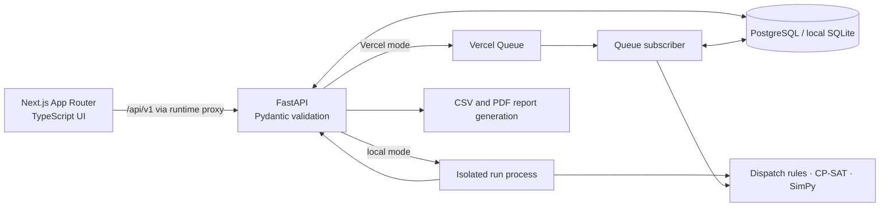

# Architecture

LINEPILOT is a manufacturing decision-support application with a TypeScript web client and a Python engineering API. The database holds production inputs and every completed run; the client reads calculated results and never reproduces scheduling mathematics in browser code. Run execution has a local process mode and a Vercel Queue mode.

## Packages

- `apps/web`: Next.js App Router interface, typed API client, theme tokens, forms, Gantt, simulation playback, analytics, and reports. Browser requests use relative `/api/v1` URLs; a runtime route proxies them to `API_INTERNAL_URL`.
- `services/api/app/api`: versioned FastAPI routes and error responses.
- `services/api/app/models.py`: normalized SQLAlchemy entities and database constraints.
- `services/api/app/snapshot.py`: converts facility calendars, downtime, jobs, and machine options into a bounded UTC minute model. It applies scenario changes to a copy.
- `services/api/app/engineering`: pure scheduling, independent validation, metric calculation, bottleneck analysis, and SimPy simulation. Functions consume JSON-compatible snapshots and return JSON-compatible results.
- `services/api/app/workers`: local isolated processes or database-fenced Vercel Queue runs. The request returns a run ID; the UI polls persisted status. Cancellation records a terminal state and signals active work to stop.
- `services/api/app/queue_subscriber.py`: private Vercel Queue consumer for scheduling and simulation.
- `services/scheduler`: private Vercel scheduled function that asks the API to republish abandoned queue runs.
- `services/api/alembic`: schema migrations. The seed module creates an idempotent fictional Northline facility.

## Schedule run lifecycle

1. The API validates the request and builds an immutable input snapshot from the selected facility and jobs. It stores the separate solver configuration with the run.
2. For a scenario, validated modifications are applied to a copy of that snapshot. The baseline production records are left intact.
3. A `ScheduleRun` row is committed in `queued` state. Local mode starts a separate worker process; Vercel mode publishes the run ID to a Queue subscriber.
4. The engine returns assignments, solver status, diagnostics, and calculated metrics. Its independent validator checks every assignment before it is saved as valid.
5. The worker stores assignments as `ScheduledOperation` rows, updates status and timing, and exposes the results through polling and analysis endpoints. Queue mode uses a database claim token so retries and duplicate messages cannot overwrite completed or cancelled results. A private scheduled function republishes abandoned runs.

The run stores its exact input snapshot. Later job edits therefore do not silently change the meaning of an earlier report. Dispatch rules and CP-SAT use the same snapshot, calendars, eligibility, and downtime windows for a fair comparison.

## Simulation and analysis lifecycle

A simulation references a persisted schedule run, then processes its stored snapshot and assignments through SimPy. The event stream, configuration, seed, and metrics are stored. The factory canvas and event log replay those events; playback speed alters only presentation timing. Analytics derive utilization, delivery, queue, and bottleneck evidence from stored runs. Reports reference specific runs and include definitions and assumptions.

## Data and time boundaries

Database timestamps are normalized to UTC before persistence. Facility-local shifts are expanded through the facility's IANA timezone into UTC operating windows, including overnight shifts. The engine uses integer minutes relative to a UTC origin. The UI formats timestamps for people while retaining absolute time in API payloads.

The local demo is single-workspace and clearly marked as fictional. The stack contains no machine telemetry, sensor integration, or fabricated performance claims. A public multi-user deployment requires authentication and authorization before the writable API is exposed.
