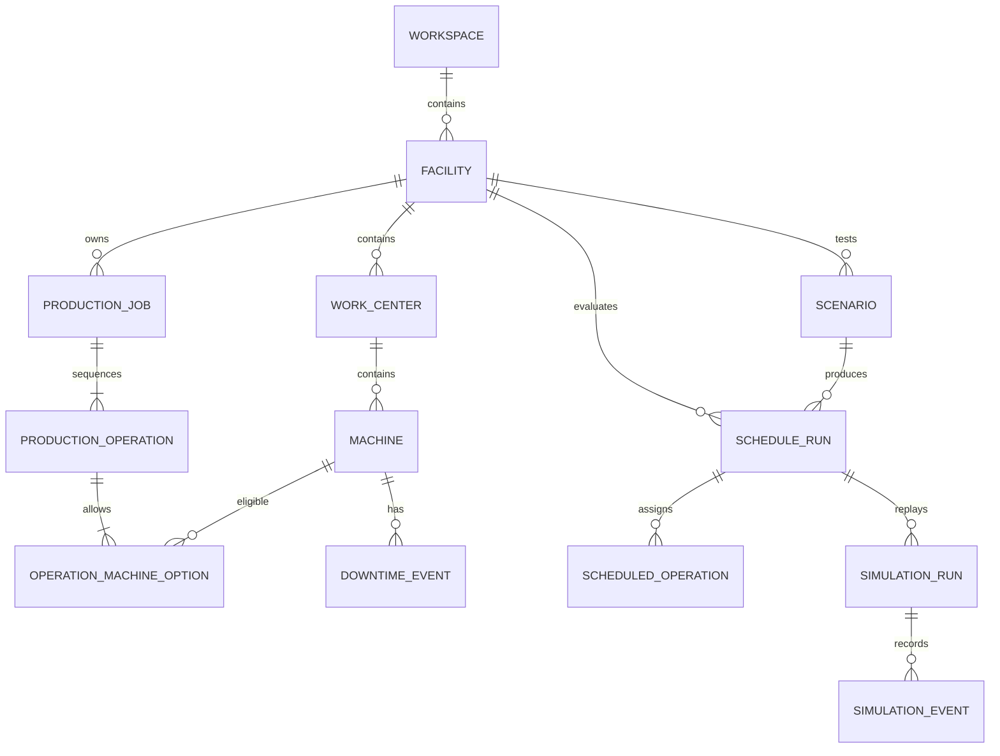

# Data model

The API persists a normalized facility model and immutable run snapshots. UUIDs identify persisted records; human-facing job, machine, work-center, and facility codes have uniqueness constraints in their relevant scope.

`OperatingCalendar` holds a timezone and recurring weekly shift windows, with holiday and closure exceptions. A facility can reference a default calendar; each machine may override it. `DowntimeEvent` is separate because machine outages are routinely queried alongside assignments. Calendar windows and downtime are converted into bounded UTC minute intervals when a scheduling snapshot is built.

`ProductionOperation` stores each step of a job. `OperationMachineOption` holds one processing duration per eligible machine, allowing a flexible job-shop model. Database constraints reject nonpositive durations and quantities, duplicate operation numbers, and duplicate machine options.

`ScheduleRun` stores the exact input snapshot, solver configuration, status, diagnostics, metrics, and timing. `ScheduledOperation` stores assignments relationally so machine timelines and job histories can be queried. A run never edits its source jobs. `Scenario` stores a list of validated modifications; evaluation applies them to a copy of the source snapshot. This prevents scenario experiments from changing the baseline facility data.

`SimulationRun` references the schedule it evaluates and stores configuration, status, summary metrics, and individual `SimulationEvent` rows. `ImportBatch` captures validation errors and imported row counts. `AuditEvent` records meaningful production-data changes. A generated report references a particular run so an export can be reproduced from persisted results.

The Northline Components Plant seed is clearly marked as fictional sample data. It is designed to let a user run real scheduling and simulation calculations immediately after installation.
